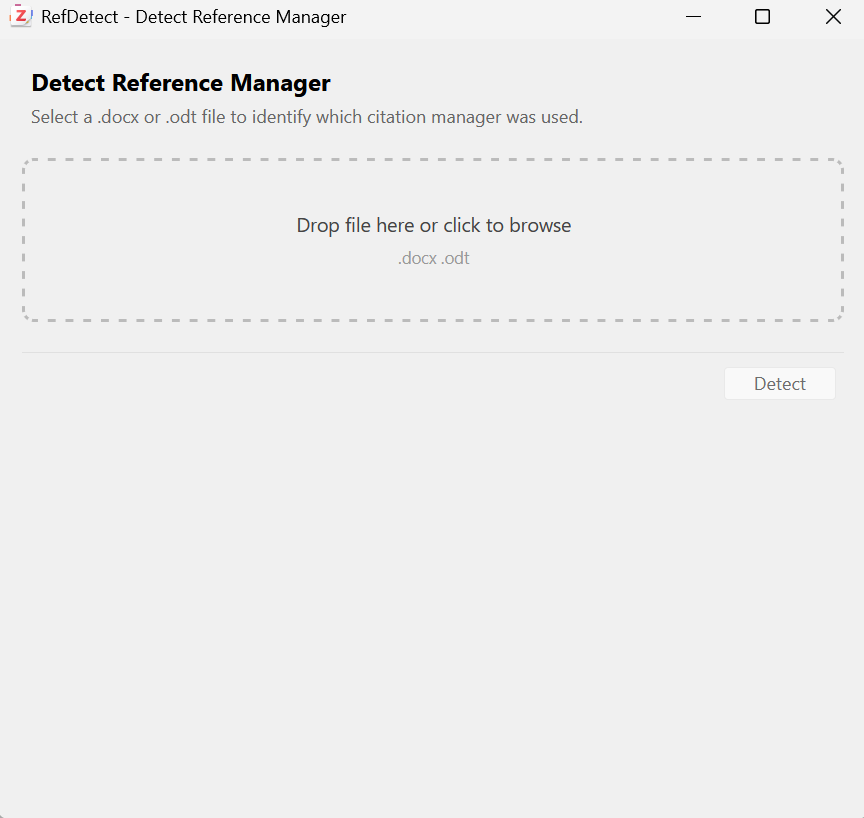

# RefDetect

RefDetect identifies the reference manager behind live citations in Word and OpenDocument files before you begin a migration or repair.



## Detected reference managers

RefDetect examines field codes, content controls, document markers, and embedded metadata. It recognizes Zotero, EndNote, Mendeley, Paperpile, RefWorks, Citavi, and several related workflows. A document can contain evidence from more than one reference manager.

The scan runs locally. RefDetect does not upload or modify the selected document.

## Checking a document

1. Open **Tools > Detect Reference Manager** in Zotero.
2. Select a `.docx` or `.odt` file.
3. Review the detected managers, citation mechanisms, and confidence notes.

## Installation

1. Download the latest `.xpi` from [Releases](https://github.com/sorinhostiuc/refdetect/releases/latest).
2. In Zotero, open **Tools > Plugins**.
3. Choose **Install Plugin From File**, select the `.xpi`, and restart Zotero if asked.

RefDetect supports Zotero 7 through 9.

## Development

```bash
npm ci
npm run build
```

## License

[MIT](LICENSE)
